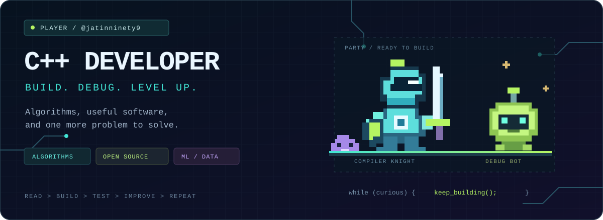
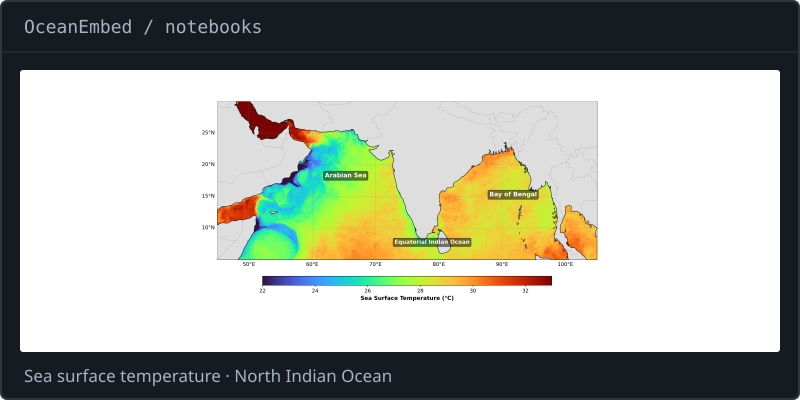
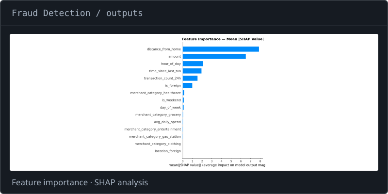
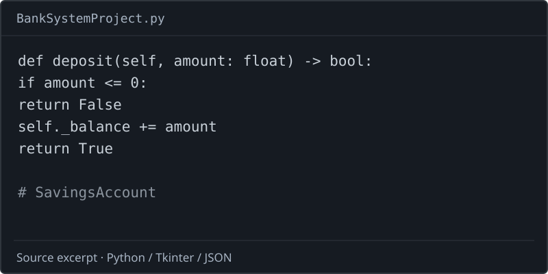
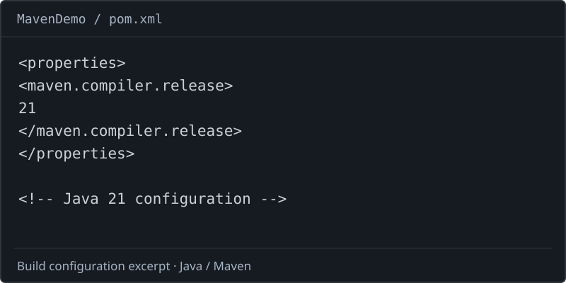

  

  <b>C++ developer. Curious builder. Always another problem to solve.</b> 
  I enjoy algorithms, open source, and turning ideas into useful software. 
  My projects also explore Python, machine learning, Java, and the web.

  <a href="#selected-projects">Selected projects</a> &nbsp; / &nbsp;
  <a href="#tech-stack">Tech stack</a> &nbsp; / &nbsp;
  <a href="#open-source">Open source</a>

## Selected projects

<table>
  <tr>
    <td width="50%" valign="top">
      
      <h3>OceanEmbed</h3>
      
Reconstructing subsurface ocean temperatures from satellite surface data with a deep learning pipeline.

      
<code>Python</code> <code>PyTorch</code> <code>FastAPI</code> <code>Docker</code>

      <a href="https://github.com/jatinninety9/OceanEmbed">Explore the project →</a>
    </td>
    <td width="50%" valign="top">
      
      <h3>Fraud Detection</h3>
      
A machine learning project with a prediction API, explainability, and a dashboard for exploring fraud signals.

      
<code>scikit-learn</code> <code>FastAPI</code> <code>SHAP</code> <code>Streamlit</code>

      <a href="https://github.com/jatinninety9/fraud-detection-project">Explore the project →</a>
    </td>
  </tr>
  <tr>
    <td width="50%" valign="top">
      
      <h3>Student Banking System</h3>
      
A desktop banking application for customers, accounts, transactions, and local JSON persistence.

      
<code>Python</code> <code>Tkinter</code> <code>JSON</code>

      <a href="https://github.com/jatinninety9/Banking-System-Project">Explore the project →</a>
    </td>
    <td width="50%" valign="top">
      
      <h3>MavenDemo</h3>
      
A Java project exploring Maven builds, compiler configuration, and executable JAR packaging.

      
<code>Java 21</code> <code>Maven</code>

      <a href="https://github.com/jatinninety9/MavenDemo">Explore the project →</a>
    </td>
  </tr>
</table>

**More projects:** [Machine learning notebooks](https://github.com/jatinninety9/Machine_Learning) · [Student feedback app](https://github.com/jatinninety9/student-feedback-app)

## Tech stack

More tools &amp; libraries

Java, JavaScript, HTML, CSS, GitHub Actions, scikit-learn, NumPy, pandas, Jupyter, Streamlit, Node.js, Express, and Vite.

| Area | Technologies |
| :--- | :--- |
| C++ toolkit | C++17, doctest, fmt, cxxopts |
| Scientific computing | SciPy, xarray, NetCDF4, h5netcdf, Cartopy, Copernicus Marine |
| Visualization & explainability | Matplotlib, Seaborn, SHAP |
| Desktop & backend | Tkinter, Uvicorn, Maven, JSON, YAML, Requests |
| Storage & deployment | PostgreSQL, SQLite, Render, Vercel |

## Open source

| Project | Contribution |
| :--- | :--- |
| [ModernCppStarter](https://github.com/TheLartians/ModernCppStarter/pull/207) | CTest smoke tests for the standalone C++ CLI and its CI workflow. |
| [Digital Certification System](https://github.com/ishu7w/digital-certification-system/pull/1) | Certificate workflow usability, accessibility, and documentation improvements. |
| [Vite dependency fix](https://github.com/ishu7w/digital-certification-system/pull/2) | A focused dependency update to resolve high severity audit findings. |

  <b>Read the problem. Build a solution. Test it. Keep improving.</b>  
  <a href="https://github.com/jatinninety9?tab=repositories">Browse all public projects →</a>

